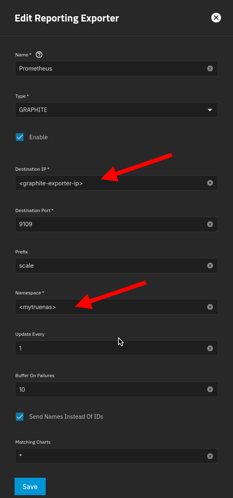

# truenas-prometheus-grafana

A simple and clean TrueNAS Core/Scale grafana dashboard based on prometheus.
This project is somewhat inspired by [truenas-grafana](https://github.com/SmellyN3rd/truenas-grafana),
however the exact setup didn't work for me (probably due to different TrueNAS versions).

- graphite-exporter: `0.16.0`
- prometheus: `3.12.0`
- TrueNAS: `25.10.7 - Goldeye`
- grafana: `13.0.12`

## Installation

If you're running your graphana prometheus stack on nixos, you can replace step 1 and 2 with [prometheus.nix](./prometheus.nix).

1. Set up [graphite-exporter](https://github.com/prometheus/graphite_exporter) with the included [mappings](graphite-mappings.yaml)

2. Add a prometheus scrape task, this is my config. If your graphite-exporter and prometheus instance
  are not running on the same machine replace localhost with the desired ip.

```yaml
# prometheus-config.yml
alerting:
  alertmanagers: []
global: {}
remote_read: []
remote_write: []
rule_files: []
scrape_configs:
- job_name: graphite
  static_configs:
  - labels:
      host: <mytruenas>.<mydomain>.com # optional
    targets:
    - localhost:9108 # replace localhost if necessary
```

3. Configure TrueNAS for pushing metrics to the graphite-exporter endpoint under `Reporting > Exporters > Add`.
<br>



4. Import the [dashboard](dashboard-truenas.json) configuration in grafana under `Dashboards > New > Import`.
<br>


